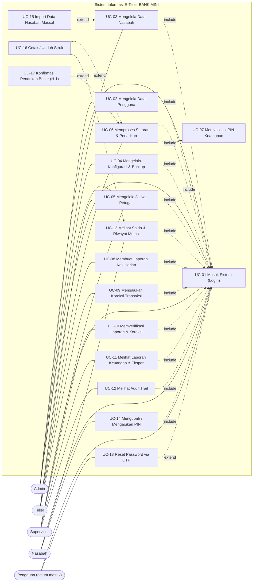
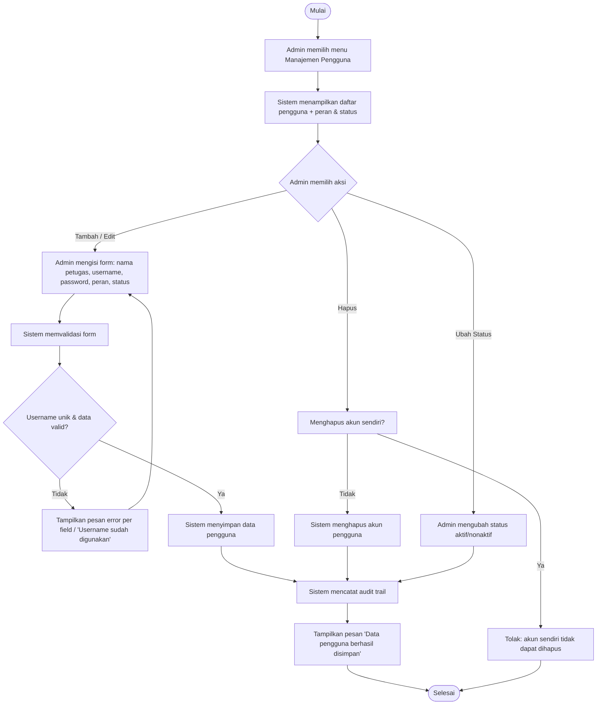
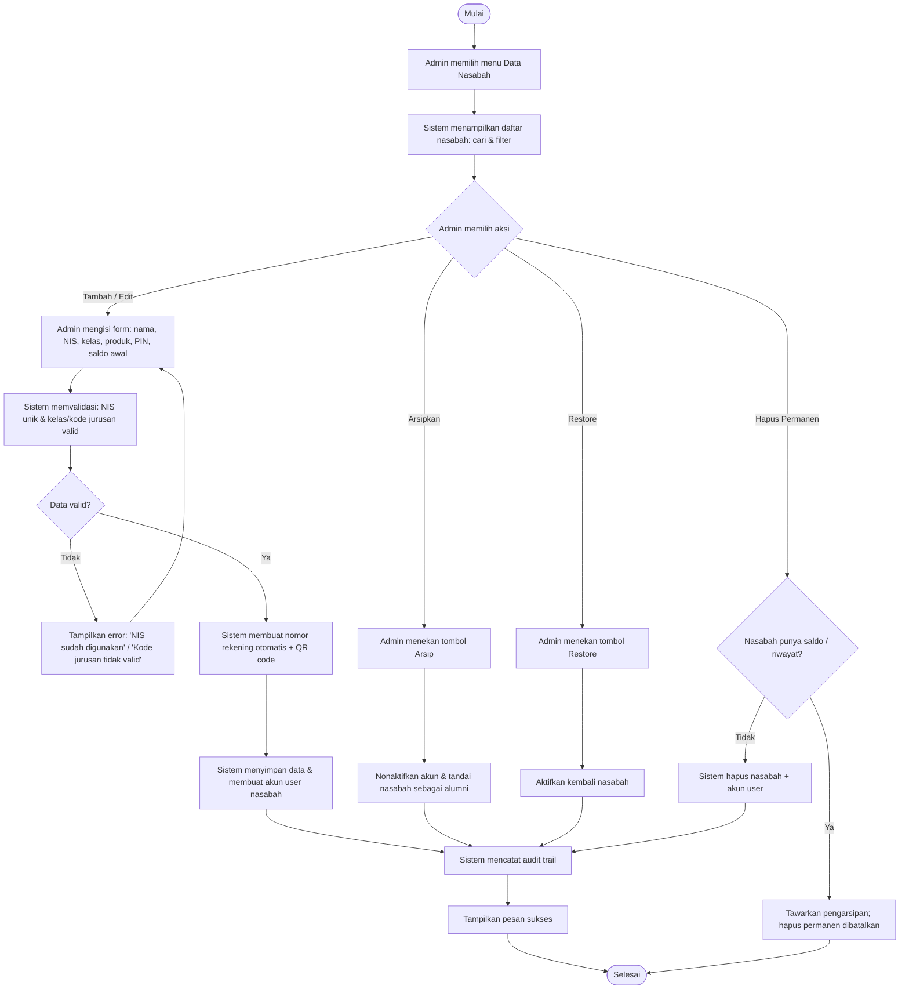
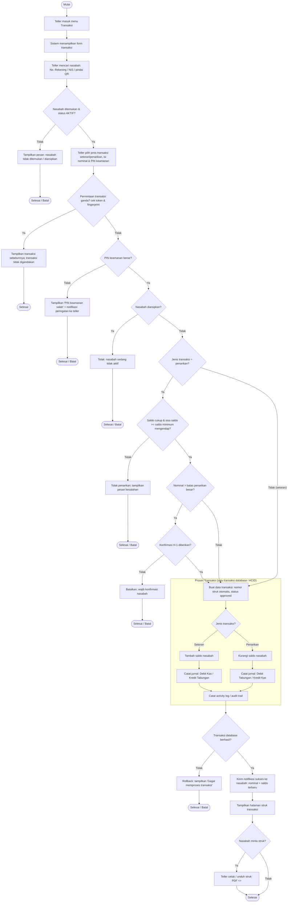
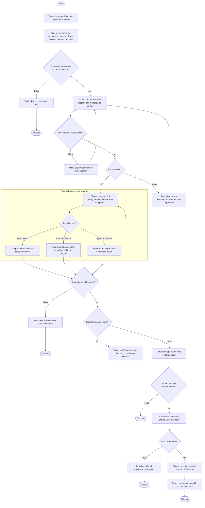

# KK 04 — Menyusun Spesifikasi Kebutuhan Perangkat Lunak
## (Activity Diagram - Wireframe)

| | |
|---|---|
| **Kode Kertas Kerja** | KK 04 |
| **Nama Kertas Kerja** | Menyusun Spesifikasi Kebutuhan Perangkat Lunak (Activity Diagram – Wireframe) |
| **Kode Unit** | J.62SAD00.006.1 |
| **Judul Unit** | Membuat Kebutuhan Dokumentasi Spesifikasi Perangkat Lunak |
| **Deskripsi Unit** | Unit kompetensi ini berhubungan dengan pengetahuan, keterampilan, dan sikap kerja yang dibutuhkan untuk mengukur kemampuan dalam membuat kebutuhan dokumentasi perangkat lunak. |
| **Elemen Unit** | 1. Menyusun dokumen Operasional<br>2. Menyusun spesifikasi kebutuhan dokumen |
| **Nama** | Muhammad Wildan Faqih Syahputra |
| **Nama Proyek** | BANK MINI — Sistem Informasi E-Teller |

**Ruang lingkup proyek:** Sistem Informasi E-Teller BANK MINI adalah aplikasi **Laravel (web)** dengan tambahan **REST API untuk aplikasi mobile** yang dipakai untuk mengelola simpanan siswa di lingkungan sekolah. Sistem melayani empat peran pengguna (Admin, Teller, Supervisor, Nasabah) dengan fitur utama: manajemen pengguna & nasabah, transaksi setoran/penarikan tunai beserta jurnal akuntansi dan struk, laporan kas, verifikasi, sampai audit trail.

---

## Use Case Diagram

> Hasil salinan dari **KK 03** (UML Use Case Diagram direpresentasikan dengan `flowchart` Mermaid: subgraph = batas sistem, node = use case, aktor = node terpisah, `include`/`extend` = garis putus-putus berlabel).



**Keterangan aktor & asosiasi:**

| Aktor | Use Case yang diakses |
|---|---|
| Admin | UC-01, UC-02, UC-03, UC-04, UC-05 |
| Teller | UC-01, UC-05, UC-06, UC-08, UC-09 |
| Supervisor | UC-01, UC-05, UC-10, UC-11, UC-12 |
| Nasabah | UC-01, UC-13, UC-14 |
| Pengguna (belum masuk) | UC-01, UC-18 |

**Relasi `<<include>>`:** UC-02 s.d. UC-14 selalu membutuhkan UC-01 (Login); UC-06 selalu membutuhkan UC-07 (Validas    i PIN).
**Relasi `<<extend>>`:** UC-15 memperluas UC-03; UC-16 memperluas UC-06 & UC-13; UC-17 memperluas UC-06 (bila nominal > batas); UC-18 memperluas UC-01 (bila lupa password).

---

## Ringkasan Use Case yang Dibuatkan Activity Diagram & Wireframe

Sesuai ketentuan (harus mencakup use case berjenis **"Mengelola"** dan **"Transaksi Utama"**), dipilih 4 use case yang dikelompokkan dalam 3 bagian:

| No | Kode | Nama Use Case | Jenis | Aktor |
|---|---|---|---|---|
| I | UC-02 | Mengelola Data Pengguna | Mengelola | Admin |
| I | UC-03 | Mengelola Data Nasabah | Mengelola | Admin |
| II | UC-06 | Memproses Transaksi Setoran & Penarikan | Transaksi Utama | Teller |
| III | UC-11 | Melihat Laporan Keuangan & Ekspor | Pelaporan | Supervisor |

> Penempatan: UC-02 dan UC-03 digabung pada bagian **I** karena keduanya berjenis "Mengelola" dan memakai pola tabel data + filter yang sama.

---

# I. Use Case "Mengelola" — UC-02 & UC-03

## I.1 UC-02 — Mengelola Data Pengguna

## Use Case Description

> Hasil salinan dari KK 03.

| Komponen | Deskripsi |
|---|---|
| **Nama Usecase** | Mengelola Data Pengguna (tambah, ubah, hapus, aktif/nonaktif akun & peran petugas) |
| **Aktor** | Admin |
| **Deskripsi** | Admin mendata akun petugas/administrator sistem (username, nama, peran, status aktif) agar akses sistem sesuai tugas masing-masing |
| **Trigger** | Admin ingin menambah/mengubah/menghapus akun pengguna |
| **Hubungan** | Asosiasi: Admin – UC-02; Include: UC-01 Masuk Sistem; Extend: – ; Generalisasi: – |
| **Pre Condition** | Admin telah login dengan peran admin; akun admin berstatus aktif |
| **Normal Flow Of Event** | 1. Admin memilih menu **Manajemen Pengguna**<br>2. Sistem menampilkan daftar pengguna beserta peran & status<br>3. Admin memilih **Tambah / Edit / Hapus**<br>4. Admin mengisi data (username, nama, peran, status)<br>5. Sistem memvalidasi (username unik, peran valid)<br>6. Sistem menyimpan perubahan dan mencatat audit trail<br>7. Sistem menampilkan pesan "Data pengguna berhasil disimpan" |
| **SubFlow** | **Subflow 1 – Menonaktifkan pengguna:** Admin mengubah status menjadi nonaktif; pengguna nonaktif tidak dapat login (middleware `check.active`).<br>**Subflow 2 – Memberi peran baru:** Admin mengubah peran (teller/supervisor/admin); menu sidebar menyesuaikan peran. |
| **Exceptional Flow** | **2a.** Username sudah dipakai → error "Username sudah digunakan".<br>**2b.** Form tidak valid → pesan validasi per field.<br>**2c.** Menghapus akun sendiri → sistem menolak. |
| **Post Condition** | Data pengguna tersimpan/diperbarui; aktivitas tercatat pada audit trail; pengguna nonaktif tidak dapat mengakses sistem |

## Activity Diagram

Digambarkan sesuai normal flow, subflow, dan exceptional flow pada Use Case Description di atas (`Admin\UserController`).



## Wireframe

**Kode Wireframe : F02.1 Daftar Pengguna (Manajemen User)**

Tampilan Wireframe :

```
+------------------------------------------------------------------------------------+
|  [=]  BANK MINI E-Teller                                        [bell] [ Admin  v ]  |
+----------------------+-------------------------------------------------------------+
|  SIDEBAR             |  Manajemen User                                             |
|  > Dashboard         |  Kelola akun petugas dan nasabah                            |
|  > Manajemen User  < |                                   +-----------------------+  |
|  > Data Nasabah      |  [ cari username / nama.... ]      | + Tambah User         |  |
|  > Jadwal Petugas    |  [ Semua Role        v ] [filter]  +-----------------------+  |
|  > Konfigurasi & Bkp |                                                             |
|  > Notifikasi        |  +-------------------------------------------------------+  |
|                      |  | # | Nama Petugas | Username | Role | Status | Aksi     |  |
|                      |  +-------------------------------------------------------+  |
|                      |  | 1 | Budi Santoso | budi     |Teller| Active | [edit][X]|  |
|                      |  | 2 | Siti Aminah  | siti     |Superv| Active | [edit][X]|  |
|                      |  | 3 | Andi Pratama | andi     |Admin | Inact. | [edit]   |  |
|                      |  |   ...                                                   |  |
|                      |  +-------------------------------------------------------+  |
|                      |              << 1 2 3 ... >> pagination                    |
+----------------------+-------------------------------------------------------------+
```

**Kode Wireframe : F02.2 Form Tambah / Edit User**

Tampilan Wireframe :

```
+------------------------------------------------------------------------------------+
|  [=]  BANK MINI E-Teller                                        [bell] [ Admin  v ]  |
+----------------------+-------------------------------------------------------------+
|  SIDEBAR             |  Tambah User                       [ <- Kembali ]            |
|  > Dashboard         |  Buat akun petugas baru                                     |
|  > Manajemen User    |                                                             |
|                      |        +-------------------------------------------+          |
|                      |        | Nama Petugas                              |          |
|                      |        | [.................................... ]  |          |
|                      |        |  Username              |  Password          |          |
|                      |        |  [..................]  |  [..............]  |          |
|                      |        |  Role                  |  Status            |          |
|                      |        |  [-- Pilih Role -- v]  |  [ Active       v] |          |
|                      |        |                                            |          |
|                      |        |  [ Simpan ]  [ Batal ]                     |          |
|                      |        +-------------------------------------------+          |
+----------------------+-------------------------------------------------------------+
```

---

## I.2 UC-03 — Mengelola Data Nasabah

## Use Case Description

> Hasil salinan dari KK 03.

| Komponen | Deskripsi |
|---|---|
| **Nama Usecase** | Mengelola Data Nasabah (tambah, ubah, arsip/restore nasabah) |
| **Aktor** | Admin |
| **Deskripsi** | Admin mendata nasabah (siswa) beserta nomor rekening, jurusan, PIN awal, dan status agar teller dapat melayani transaksi |
| **Trigger** | Admin ingin menambah/mengubah/mengarsipkan data nasabah |
| **Hubungan** | Asosiasi: Admin – UC-03; Include: UC-01 Masuk Sistem; Extend: UC-15 Import Data Nasabah Massal (bila impor Excel); Generalisasi: – |
| **Pre Condition** | Admin telah login dengan peran admin; format nomor rekening mengikuti konfigurasi kode jurusan |
| **Normal Flow Of Event** | 1. Admin memilih menu **Data Nasabah**<br>2. Sistem menampilkan daftar nasabah (cari/filter)<br>3. Admin memilih **Tambah / Edit**<br>4. Admin mengisi data (nama, NIS, kode jurusan, PIN, dsb.)<br>5. Sistem memvalidasi (NIS unik, kode jurusan sesuai konfigurasi)<br>6. Sistem membuat nomor rekening otomatis dan menyimpan<br>7. Sistem menampilkan pesan sukses dan mencatat audit trail |
| **SubFlow** | **Subflow 1 – Arsipkan nasabah:** Admin menekan **Arsip**; nasabah tidak dapat dilayani transaksi (dicek pada UC-06).<br>**Subflow 2 – Pulihkan nasabah:** Admin menekan **Restore**; nasabah kembali aktif. |
| **Exceptional Flow** | **2a.** NIS sudah terdaftar → error "NIS sudah digunakan".<br>**2b.** Kode jurusan tidak ada → "Kode jurusan tidak valid".<br>**2c.** Nasabah punya saldo/riwayat lalu diminta hapus permanen → sistem menawarkan pengarsipan. |
| **Post Condition** | Data nasabah tersimpan/diperbarui/diarsipkan; nomor rekening terbentuk; teller dapat melayani nasabah aktif |

## Activity Diagram

Digambarkan sesuai normal flow, subflow, dan exceptional flow pada Use Case Description di atas (`Admin\NasabahController`).



## Wireframe

**Kode Wireframe : F03.1 Daftar Nasabah**

Tampilan Wireframe :

```
+------------------------------------------------------------------------------------+
|  [=]  BANK MINI E-Teller                                        [bell] [ Admin  v ]  |
+----------------------+-------------------------------------------------------------+
|  SIDEBAR             |  Manajemen Nasabah                                          |
|  > Dashboard         |  Kelola data rekening siswa                                 |
|  > Manajemen User    |  [ cari nama/rek/NIS ] [Kelas v][Status v][filter]          |
|  > Data Nasabah   <  |  [ + Tambah Nasabah ]  [ Import CSV ]                       |
|  > Jadwal Petugas    |                                                             |
|  > Konfigurasi & Bkp |  +-------------------------------------------------------+  |
|                      |  | # | No.Rek | NIS  | Nama Siswa |Kelas| Saldo | Aksi   |  |
|                      |  +-------------------------------------------------------+  |
|                      |  | 1 |RPL-001 |24001 | Dwi Lestari|XI RPL|50.000|[e][A]  |  |
|                      |  | 2 |DKV-002 |24002 | Rizky Adi  |XI DKV|20.000|[e][A]  |  |
|                      |  | 3 |RPL-003 |23011 | Anisa Putri|Alumni| 0    |[e][R][X]|  |
|                      |  +-------------------------------------------------------+  |
|                      |   A = Arsipkan   R = Restore   X = Hapus permanen           |
+----------------------+-------------------------------------------------------------+
```

**Kode Wireframe : F03.2 Form Tambah / Edit Nasabah**

Tampilan Wireframe :

```
+------------------------------------------------------------------------------------+
|  [=]  BANK MINI E-Teller                                        [bell] [ Admin  v ]  |
+----------------------+-------------------------------------------------------------+
|  SIDEBAR             |  Tambah Nasabah                    [ <- Kembali ]            |
|  > Dashboard         |  Buat rekening siswa baru                                   |
|  > Data Nasabah      |                                                             |
|                      |        +-------------------------------------------+          |
|                      |        | Nama Lengkap                              |          |
|                      |        | [.................................... ]  |          |
|                      |        |  NIS (username login) | Kelas              |          |
|                      |        |  [..................] | [ Pilih kelas  v]  |          |
|                      |        |  Produk Tabungan      | Email (opsional)   |          |
|                      |        |  [ Tabungan Siswa  v] | [ .............. ] |          |
|                      |        |  PIN (6 digit)        | Konfirmasi PIN     |          |
|                      |        |  [ ...... ]           | [ ...... ]         |          |
|                      |        |  Saldo Awal (Rp)                          |          |
|                      |        |  [ 0               ]                      |          |
|                      |        |  (i) Nomor rekening dibuat otomatis,      |          |
|                      |        |      contoh RPL-001 beserta QR code       |          |
|                      |        |  [ Simpan ]   [ Batal ]                   |          |
|                      |        +-------------------------------------------+          |
+----------------------+-------------------------------------------------------------+
```

---

# II. Use Case "Transaksi Utama" : UC-06 — Memproses Transaksi Setoran & Penarikan

## Use Case Description

> Hasil salinan dari KK 03.

| Komponen | Deskripsi |
|---|---|
| **Nama Usecase** | Memproses Transaksi Setoran & Penarikan |
| **Aktor** | Teller |
| **Deskripsi** | Teller melayani setoran & penarikan tunai nasabah: memvalidasi PIN, memproses perubahan saldo, mencatat jurnal akuntansi, dan menerbitkan struk |
| **Trigger** | Teller memilih menu **Transaksi** dan menekan tombol **Proses** |
| **Hubungan** | Asosiasi: Teller – UC-06; Include: UC-01, UC-07 Memvalidasi PIN Keamanan; Extend: UC-17 Konfirmasi Penarikan Besar (H-1), UC-16 Cetak/Unduh Struk; Generalisasi: – |
| **Pre Condition** | Teller telah login dengan peran teller; nasabah ditemukan & aktif; saldo awal kas laci diketahui sistem |
| **Normal Flow Of Event** | 1. Teller mencari nasabah (No. Rekening / NIS / pindai QR)<br>2. Sistem menampilkan data nasabah<br>3. Teller memilih jenis (**setoran/penarikan**), mengisi nominal dan **PIN keamanan**<br>4. Sistem memvalidasi PIN, saldo, saldo minimum, dan anti transaksi ganda, lalu memproses dalam satu transaksi database (buat transaksi + ubah saldo + catat jurnal + activity log)<br>5. Sistem menampilkan halaman struk (nomor struk, jenis, nominal, saldo akhir) |
| **SubFlow** | **Subflow 1 – Setoran:** saldo ditambah; jurnal **Debit Kas / Kredit Tabungan**.<br>**Subflow 2 – Penarikan:** saldo dikurangi (setelah cek saldo & saldo mengendap); jurnal **Debit Tabungan / Kredit Kas**; notifikasi sukses ke nasabah. |
| **Exceptional Flow** | **2a.** PIN salah → transaksi dibatalkan + notifikasi peringatan ke teller.<br>**2b.** Nasabah diarsipkan → "Nasabah sedang tidak aktif".<br>**3a.** Penarikan > saldo → "Saldo tidak mencukupi".<br>**3b.** Sisa saldo < saldo minimum → ditolak.<br>**3c.** Penarikan > batas tanpa konfirmasi H-1 → ditolak.<br>**4a.** Form dikirim ulang/klik ganda → transaksi tidak digandakan.<br>**4b.** Kegagalan database → rollback, "Gagal memproses transaksi". |
| **Post Condition** | Transaksi tersimpan dengan nomor struk; saldo & jurnal sesuai; notifikasi terkirim; audit trail tercatat; struk siap dicetak/diunduh PDF |

## Activity Diagram

Digambarkan sesuai User Description pada KK 03 dan implementasi `Teller\TransaksiController@proses`.



## Wireframe

**Kode Wireframe : F06.1 Loket Transaksi Teller (Cari Nasabah & Form Transaksi)**

Tampilan Wireframe :

```
+------------------------------------------------------------------------------------+
|  [=]  BANK MINI E-Teller                          [Loket Aktif] [Scan QR][Teller v] |
+----------------------+-------------------------------------------------------------+
|  SIDEBAR             |  Transaksi — Loket Teller, Senin 13 Oktober 2026            |
|  > Dashboard         |  +----------------------------+  +----------------------+  |
|  > Transaksi      <  |  | Cari Nasabah               |  | Form Transaksi       |  |
|  > Laporan Kas       |  | [QR/ No.Rek / NIS] [cari]  |  | (Jenis) Setoran|Tarik|  |
|  > Jadwal Petugas    |  +----------------------------+  | Pemilik: Dwi Lestari |  |
|  > Notifikasi        |  | Nasabah                    |  | Rek    : RPL-001     |  |
|                      |  | [DL] Dwi Lestari    Aktif   |  | Nominal: Rp [......] |  |
|                      |  | Rek: RPL-001 · NIS: 24001  |  |  Saldo sekarang Rp.. |  |
|                      |  | Saldo: Rp 50.000           |  |  Estimasi sesudah Rp.|  |
|                      |  +----------------------------+  | Catatan: [........]  |  |
|                      |                                  | PIN Keamanan: [******]| |
|                      |                                  | [Reset][Proses Trans.]| |
|                      |  (Jika belum cari)               +----------------------+  |
|                      |  [ Transaksi Terbaru Loket : filter .......... ]            |
|                      |  | No.Struk | Waktu | Nasabah | Jenis | Nominal | Aksi |   |
+----------------------+-------------------------------------------------------------+
```

**Kode Wireframe : F06.2 Struk / Bukti Transaksi**

Tampilan Wireframe :

```
+------------------------------------------------------------------------------------+
|  [=]  BANK MINI E-Teller                                        [bell] [Teller  v ]  |
+----------------------+-------------------------------------------------------------+
|  SIDEBAR             |  Struk Transaksi                                            |
|  > Transaksi         |  [ v Transaksi berhasil diproses. ] [Lihat][Cetak][PDF]     |
|                      |  [ <- Kembali ]  [ Lihat Struk ]  [ Cetak ]  [ Download PDF]|
|                      |  +-------------------------------------------+  +---------+ |
|                      |  |  [BM] BANK MINI          BUKTI TRANSAKSI  |  | Info    | |
|                      |  |       E-Teller Sekolah    No. TRX-20261013|  | Struk   | |
|                      |  |-------------------------------------------|  |         | |
|                      |  | Data Nasabah           | Detail Transaksi |  | [Lihat] | |
|                      |  | Nama : Dwi Lestari     | Jenis : Setoran  |  | [Cetak] | |
|                      |  | Rek  : RPL-001         | Nominal: 20.000  |  | [ PDF ] | |
|                      |  | NIS  : 24001           | Sblm : 50.000    |  +---------+ |
|                      |  | Kelas: XI RPL          | Ssdh : 70.000    |            |
|                      |  | Petugas: Teller A      | Status: Approved |            |
|                      |  |-------------------------------------------|            |
|                      |  |   [QR verifikasi]   Teller: __________    |            |
|                      |  +-------------------------------------------+            |
+----------------------+-------------------------------------------------------------+
```

---

# III. Use Case "Pelaporan" : UC-11 — Melihat Laporan Keuangan & Ekspor

## Use Case Description

> Hasil salinan dari KK 03.

| Komponen | Deskripsi |
|---|---|
| **Nama Usecase** | UC-11 Melihat Laporan Keuangan & Ekspor |
| **Aktor** | Supervisor |
| **Deskripsi** | Supervisor melihat laporan keuangan (buku besar, laporan harian, dan laporan tahunan), menentukan periode laporan, serta mengekspor atau mengunduh laporan |
| **Trigger** | Supervisor memilih menu **Laporan Keuangan** dan menentukan jenis laporan serta periode yang ingin dilihat |
| **Hubungan** | Asosiasi: Supervisor – UC-11; Include: UC-01 Masuk Sistem; Extend: Ekspor/Unduh Laporan (PDF/Excel); Generalisasi: – |
| **Pre Condition** | Supervisor telah login dengan peran Supervisor dan memiliki hak akses melihat laporan keuangan; data transaksi telah tercatat di dalam sistem |
| **Normal Flow Of Event** | 1. Supervisor memilih menu **Laporan Keuangan**<br>2. Sistem menampilkan pilihan jenis laporan: buku besar, laporan harian, laporan tahunan<br>3. Supervisor memilih jenis laporan dan menentukan periode (tanggal atau tahun)<br>4. Sistem mengambil dan mengolah data sesuai jenis laporan & periode<br>5. Sistem menampilkan laporan beserta total dan rinciannya<br>6. Supervisor memeriksa laporan dan memilih ekspor/unduh bila diperlukan<br>7. Sistem menghasilkan file laporan (PDF/Excel) dan menyediakannya untuk diunduh |
| **SubFlow** | **Subflow 1 – Melihat Buku Besar:** Supervisor memilih Buku Besar; sistem menampilkan buku besar + saldo awal/akhir periode; Supervisor memeriksa saldo & rincian.<br>**Subflow 2 – Melihat Laporan Harian:** sistem menampilkan rekap transaksi pada tanggal dipilih (total setoran, total penarikan, saldo).<br>**Subflow 3 – Melihat Laporan Tahunan:** Supervisor menentukan tahun; sistem menampilkan rekap sepanjang tahun (per bulan).<br>**Subflow 4 – Ekspor/Unduh:** Supervisor menekan tombol Ekspor/Unduh; sistem menghasilkan file PDF/Excel untuk diunduh. |
| **Exceptional Flow** | **1a.** Pengguna tidak memiliki hak akses → akses ditolak + dicatat pada audit trail.<br>**2a.** Jenis laporan belum dipilih → sistem meminta Supervisor memilih jenis laporan.<br>**3a.** Periode tidak valid → pesan kesalahan, minta periode diperbaiki.<br>**4a.** Data laporan tidak ditemukan → "Data laporan tidak ditemukan".<br>**4b.** Gagal mengambil data → "Gagal memuat laporan" + opsi mencoba kembali.<br>**6a.** Ekspor gagal → "Gagal mengekspor laporan". |
| **Post Condition** | Laporan tampil sesuai jenis & periode; bila Supervisor mengekspor, file tersedia untuk diunduh; akses dan ekspor laporan tercatat pada audit trail |

## Activity Diagram

Digambarkan sesuai normal flow, subflow, dan exceptional flow pada Use Case Description di atas (`Supervisor\LaporanController`: `bukuBesar`, `laporanHarian`, `laporanTahunan`).



## Wireframe

> Sesuai permintaan, untuk UC-11 cukup **Activity Diagram** (wireframe visual dibuat terpisah di tool desain).

**Kode Wireframe : F11.1 Daftar Laporan Keuangan (Buku Besar / Harian / Tahunan)**

Tampilan Wireframe :

(Placeholder — belum dibuat)

---

## Catatan Kesesuaian

- Activity Diagram dan Wireframe disusun konsisten dengan Use Case Description dari KK 03 dan dengan implementasi nyata pada aplikasi (route & controller):
  - UC-02 → `admin.users.index`, `admin.users.create`, `admin.users.store/edit/update/destroy`.
  - UC-03 → `admin.nasabah.index`, `admin.nasabah.create`, `admin.nasabah.store/edit/update/arsip/restore/destroy`.
  - UC-06 → `teller.transaksi.index`, `teller.transaksi.cari`, `teller.transaksi.proses`, serta halaman `struk`.
- Wireframe menggunakan gaya antarmuka sistem sebenarnya (sidebar BANK MINI E-Teller, panel data, badge status, dan tabel aksi).
