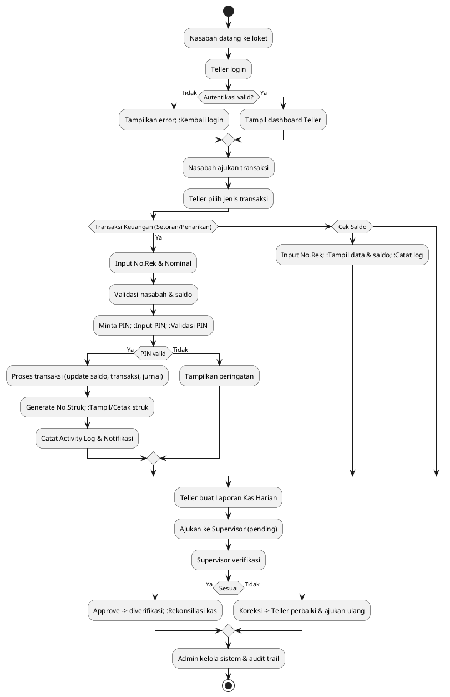
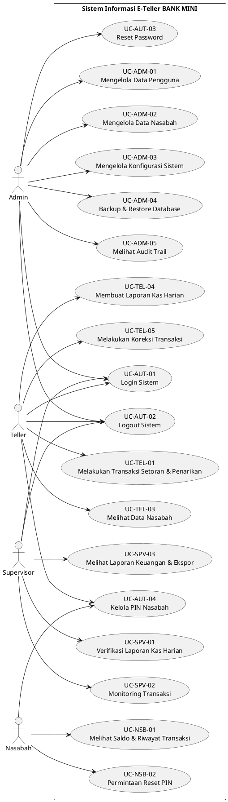
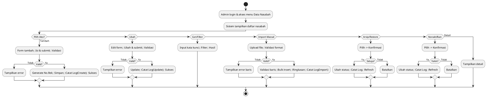
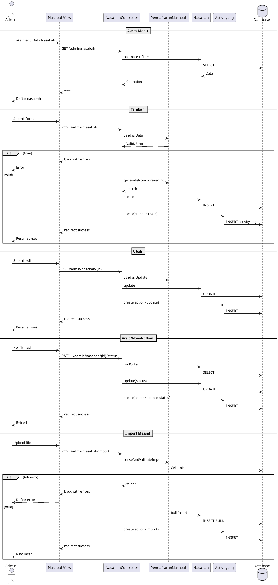
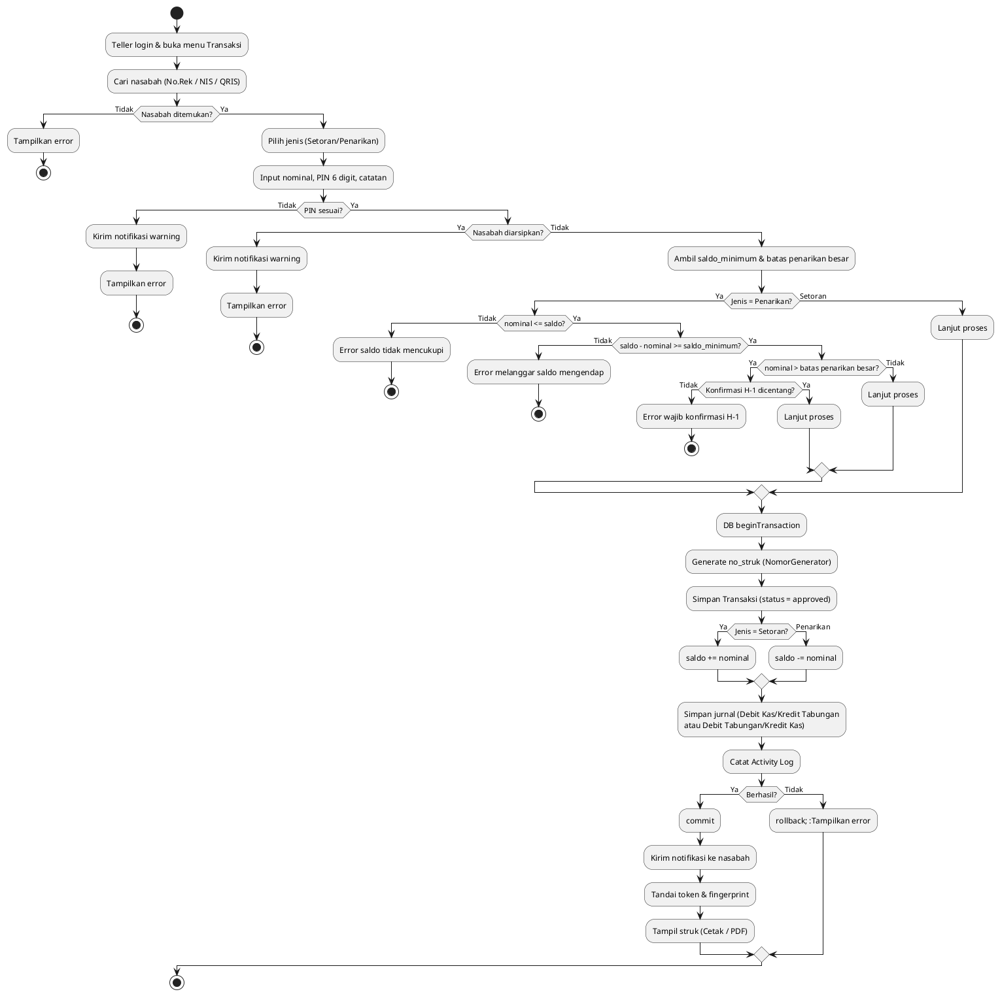
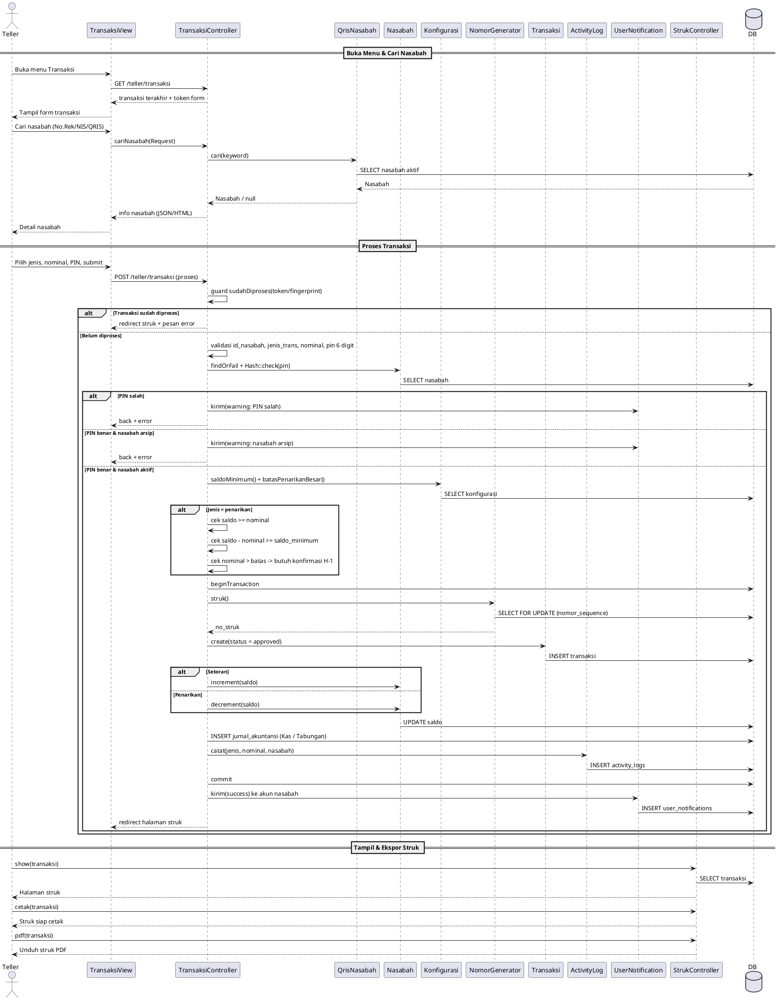
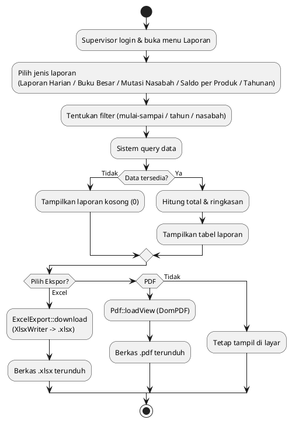
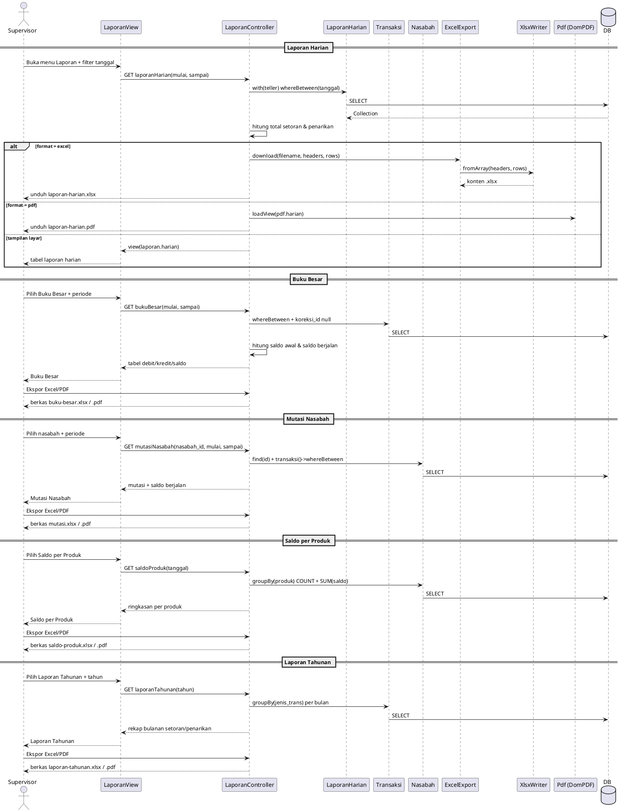

# KK 05 — Menyusun Spesifikasi Kebutuhan Perangkat Lunak
**(Sequence Diagram – Class Diagram)**

| | |
|---|---|
| **Kode Kertas Kerja** | KK 05 |
| **Nama Kertas Kerja** | Menyusun Spesifikasi Kebutuhan Perangkat Lunak (Sequence Diagram – Class Diagram) |
| **Kode Unit** | J.62SAD00.006.1 |
| **Judul Unit** | Membuat Kebutuhan Dokumentasi Spesifikasi Perangkat Lunak |
| **Deskripsi Unit** | Unit kompetensi ini berhubungan dengan pengetahuan, keterampilan, dan sikap kerja yang dibutuhkan untuk mengukur kemampuan dalam membuat kebutuhan dokumentasi perangkat lunak. |
| **Elemen Unit** | 1. Menyusun dokumen Operasional 2. Menyusun spesifikasi kebutuhan dokumen |
| **Nama Siswa** | Muhammad Wildan Faqih Syahputra |
| **Nama Proyek** | BANK MINI — Sistem Informasi E-Teller |

---

## 1. Proses Bisnis To-Be System

Berdasarkan hasil analisis pada KK 03, proses bisnis *To-Be System* Sistem Informasi E-Teller BANK MINI dirancang untuk menggantikan proses manual menjadi terkomputerisasi, terintegrasi, terdokumentasi secara otomatis (*audit trail*), serta menerapkan kontrol (validasi PIN, verifikasi Supervisor, jurnal akuntansi otomatis).

### 1.1 Activity Diagram – Proses Bisnis To-Be System



---

## 2. Use Case Diagram



---

## 3. Pemilihan 3 (Tiga) Use Case

| No | Kode Use Case | Nama Use Case | Jenis Use Case | Aktor Utama |
|---|---|---|---|---|
| **I.** | UC-ADM-02 | **Mengelola Data Nasabah** | **Mengelola (Management)** | Admin |
| **II.** | UC-TEL-01 | **Melakukan Transaksi Setoran & Penarikan** | **Transaksi Utama (Core Transaction)** | Teller |
| **III.** | UC-SPV-03 | **Melihat Laporan Keuangan & Ekspor** | **Pelaporan (Reporting)** | Supervisor |

---

## I. USE CASE PERTAMA : UC-ADM-02 – Mengelola Data Nasabah

### I.1 Use Case Description

| Item | Keterangan |
|---|---|
| **Nomor Use Case** | UC-ADM-02 |
| **Nama Use Case** | Mengelola Data Nasabah |
| **Aktor Utama** | Admin |
| **Aktor Pendukung** | Sistem |
| **Tujuan** | Memungkinkan Admin menambah, mengubah, mengarsip/restore, mencari, menampilkan dan mengimpor data nasabah. |
| **Kondisi Awal** | Admin login & berada pada menu Data Nasabah. |
| **Pre-Condition** | Sistem aktif & database terhubung. |
| **Post-Condition** | Data nasabah tersimpan/terupdate/terarsip & tercatat di Activity Log. |
| **Deskripsi Alur** | 1. Admin buka menu Data Nasabah 2. Sistem tampilkan daftar 3. Pilih aksi (Tambah/Ubah/Detail/Arsip/Restore/Nonaktifkan/Import) 4. Validasi 5. Simpan 6. Catat Activity Log 7. Tampilkan pesan sukses |
| **Alur Normal** | Akses menu -> Tampilkan daftar -> Pengelolaan -> Validasi & simpan -> Notifikasi |
| **Alur Alternatif** | Cari Data, Import Massal (Excel/CSV), Arsip/Restore |
| **Alur Pengecualian** | Duplikat NIK/No.Rek/Email, format file salah, data tidak ditemukan, koneksi gagal |
| **Prioritas** | Tinggi (High) |
| **Frekuensi** | Berkala (harian/mingguan) |

### I.2 Activity Diagram – UC-ADM-02



### I.3 Wireframe – UC-ADM-02

**Kode Wireframe :** WF-ADM-02
**Nama Wireframe :** Halaman Manajemen Data Nasabah (Admin)

| Komponen UI | Deskripsi |
|---|---|
| Header/Navbar | Menu Admin (Dashboard, Pengguna, Nasabah, Konfigurasi, Backup, Audit Trail) |
| Judul Halaman | "Manajemen Data Nasabah" |
| Toolbar Aksi | + Tambah Nasabah, Import Excel/CSV, Refresh |
| Pencarian/Filter | Search (Nama/NIK/No.Rek), Filter Status |
| Tabel Data Nasabah | No, No.Rek, NIK, Nama, Alamat, No.HP, Status, Saldo, Aksi |
| Form Modal | NIK*, Nama*, TTL, Alamat*, No.HP*, Email, JK, Status, Simpan/Batal |
| Modal Konfirmasi | Konfirmasi Arsip/Nonaktifkan |
| Modal Import | Upload .xlsx/.csv, Template, Preview Error |
| Footer | Info sistem & hak cipta |

### I.4 Sequence Diagram – UC-ADM-02



### I.5 Class – UC-ADM-02

**A. Nasabah (app/Models/Nasabah.php)**

Data: id(PK), nomor_rekening(unique), nik(unique), nama_lengkap, tempat_lahir, tanggal_lahir(date), jenis_kelamin(enum), alamat(text), no_hp, email(unique), saldo(decimal 15,2), status(enum), pin(hashed), tanggal_daftar(date), keterangan(text), deleted_at, created_at, updated_at

Method: transaksi():HasMany, user():BelongsTo, getSaldoFormattedAttribute():string, scopeAktif():Builder, scopeTerarsip():Builder, scopeCari($kw):Builder, generateNomorRekening():string, updateSaldo($nominal,$tipe):bool, isAktif():bool, verifyPin($pin):bool, cekSaldoCukup():bool

**B. NasabahController (app/Http/Controllers/Admin/NasabahController.php)**

Method: index(Request):View, create():View, store(Request):RedirectResponse, show(Nasabah):View, edit(Nasabah):View, update(Request,Nasabah):RedirectResponse, destroy(Nasabah):RedirectResponse, updateStatus(Request,Nasabah):RedirectResponse|JsonResponse, import(Request):RedirectResponse

**C. ActivityLog (app/Models/ActivityLog.php)**

Data: user_id, action, model_type, model_id, old_values(json), new_values(json), ip_address, user_agent, description, created_at, updated_at

Method: log($action,$model,$changes):self

**D. PendaftaranNasabah (app/Support/PendaftaranNasabah.php)**

Method: validasiData(Request), validasiUpdate(Request,$id), generateNomorRekening(), parseAndValidateImport($file), bulkInsert($data)

---

## II. USE CASE KEDUA : UC-TEL-01 – Melakukan Transaksi Setoran & Penarikan

> **Catatan revisi:** UC-TEL-01 (Setoran) dan UC-TEL-02 (Penarikan) digabung menjadi satu use case karena di kode program keduanya ditangani oleh satu method yang sama (`Teller\TransaksiController::proses`), hanya dibedakan oleh parameter `jenis_trans` (`setoran`/`penarikan`).

### II.1 Use Case Description

| Item | Keterangan |
|---|---|
| **Nomor Use Case** | UC-TEL-01 |
| **Nama Use Case** | Melakukan Transaksi Setoran & Penarikan |
| **Aktor Utama** | Teller |
| **Aktor Pendukung** | Nasabah, Sistem |
| **Tujuan** | Memproses setoran dan penarikan tunai dalam satu alur terkendali (validasi PIN keamanan, saldo minimum, konfirmasi H-1 penarikan besar), tercatat pada jurnal & audit trail, serta menghasilkan struk. |
| **Kondisi Awal** | Teller login & berada pada menu Transaksi; nasabah aktif (tidak diarsipkan). |
| **Pre-Condition** | Sistem aktif, database terhubung, nasabah terdaftar & tidak diarsipkan. |
| **Post-Condition** | Saldo nasabah bertambah (setoran) atau berkurang (penarikan); baris `transaksi` + `jurnal_akuntansi` + `activity_logs` tercatat; notifikasi terkirim; struk dapat ditampilkan/dicetak/diunduh PDF. |
| **Deskripsi Alur** | 1. Teller buka menu Transaksi 2. Cari nasabah (No.Rek/NIS/QRIS) 3. Pilih jenis (setoran/penarikan), isi nominal, PIN 6 digit & catatan 4. Submit 5. Validasi PIN & status nasabah 6. Validasi saldo (khusus penarikan) & konfirmasi H-1 bila melebihi batas 7. Proses DB Transaction 8. Generate no_struk 9. Simpan Transaksi + jurnal + Activity Log 10. Kirim notifikasi 11. Tampilkan struk |
| **Alur Normal** | Cari nasabah -> input jenis/nominal/PIN -> validasi -> DB transaction -> struk |
| **Alur Alternatif** | Pencarian via QRIS/QR Code (`QrisNasabah::cari`), cetak ulang / unduh PDF struk (`StrukController`), guard transaksi ganda (token form & fingerprint) |
| **Alur Pengecualian** | PIN salah, nasabah diarsipkan, saldo tidak mencukupi, melanggar saldo mengendap minimum, penarikan besar tanpa konfirmasi H-1, kegagalan commit (rollback), submit ganda |
| **Prioritas** | Sangat Tinggi (Critical) |
| **Frekuensi** | Tinggi (harian) |

### II.2 Activity Diagram – UC-TEL-01



### II.3 Wireframe – UC-TEL-01

**Kode Wireframe :** WF-TEL-01
**Nama Wireframe :** Form Transaksi Setoran / Penarikan (Teller)

| Komponen | Deskripsi |
|---|---|
| Header/Navbar | Navbar Teller (Dashboard, Transaksi, Laporan Kas, Koreksi) |
| Judul Halaman | "Transaksi Setoran / Penarikan" |
| Panel Pencarian Nasabah | Input No.Rekening / NIS / scan QRIS + tombol Cari (endpoint `cariNasabah`) |
| Panel Info Nasabah | nama_siswa, no_rekening, produk, status (aktif/arsip), saldo saat ini |
| Form Transaksi | Jenis (radio Setoran/Penarikan)*, Nominal (Rp.)*, PIN Keamanan (6 digit, masked)*, Konfirmasi H-1 (checkbox, muncul bila penarikan > batas), Catatan (opsional) |
| Panel Batas | Info saldo minimum & batas penarikan besar (dari Konfigurasi) |
| Preview Saldo | Saldo sebelum -> sesudah (dinamis sesuai jenis & nominal) |
| Tombol | Proses Transaksi, Batal/Reset |
| Tabel Transaksi Terakhir | 10 transaksi terakhir milik teller |
| Halaman Struk | no_struk, tanggal/jam, teller, nasabah, jenis, nominal, saldo sebelum/sesudah, tombol Cetak (`StrukController::cetak`) & Unduh PDF (`StrukController::pdf`) |
| Notifikasi | Sukses/Error (flash message) |

### II.4 Sequence Diagram – UC-TEL-01



### II.5 Class – UC-TEL-01

**A. Transaksi (app/Models/Transaksi.php)**

Data: id, id_nasabah(FK), id_user(FK), tanggal, jenis_trans(setoran/penarikan), nominal, konfirmasi_h1, catatan, no_struk, status, dikoreksi, koreksi_id, approved_by, approved_at, created_at, updated_at

Method: nasabah():BelongsTo, user():BelongsTo, koreksi():BelongsTo, jurnal():HasMany, detailLaporan():HasMany, getNominalRupiahAttribute():string, getJenisLabelAttribute():string, getStatusLabelAttribute():string, getIsSetoranAttribute():bool, getIsPenarikanAttribute():bool, getSaldoSebelumAttribute():int, getSaldoSesudahAttribute():int, getStrukUrlAttribute():?string, getStrukCetakUrlAttribute():?string, getStrukPdfUrlAttribute():?string, isKoreksi():bool, isPending():bool

**B. TransaksiController (app/Http/Controllers/Teller/TransaksiController.php)**

Method: index(Request):View, cariNasabah(Request):View|JsonResponse, proses(Request):RedirectResponse

Helper: tokenForm(Request):string, sudahDiproses(Request):?int, sudahDiprosesFingerprint(Request):?int, catatFingerprint(Request,int):void, tandaiDiproses(Request,int):void, catatJurnal(int,int,string):void

**C. Nasabah (app/Models/Nasabah.php)**

Data: id, user_id(FK), no_rekening(unique), kode_jurusan, qr_code, nis, nama_siswa, kelas, produk, pin_keamanan(hash), saldo, arsip, created_at, updated_at

Method: isArsip():bool, ensureUser():User, getStatusAttribute():string, getProdukLabelAttribute():string, getSaldoRupiahAttribute():string, user():BelongsTo, transaksi():HasMany

**D. Konfigurasi (app/Models/Konfigurasi.php)**

Data: id, key_name(unique), value, deskripsi, updated_by, created_at, updated_at

Method: nilai(string,mixed):mixed, saldoMinimum():int, batasPenarikanBesar():int, kasAwalHarian():int, set(string,mixed,?string,?int):self

**E. NomorGenerator (app/Support/NomorGenerator.php)**

Method: struk():string, rekening(string):string, ambilUrutan(string,int):int

**F. ActivityLog (app/Models/ActivityLog.php)**

Data: id, id_user(FK), aktivitas, deskripsi, ip_address, created_at, updated_at

Method: user():BelongsTo, catat(?int,string,?string):void

**G. UserNotification (app/Models/UserNotification.php)**

Data: id, user_id(FK), tipe, judul, pesan, url, read_at, created_at, updated_at

Method: user():BelongsTo, kirim(User|int,string,string,?string,?string):self, tandaiDibaca():void, getSudahDibacaAttribute():bool

**H. QrisNasabah (app/Support/QrisNasabah.php)**

Method: payload(Nasabah):string, svg(Nasabah,int,int):string, cari(string):?Nasabah

**I. StrukController (app/Http/Controllers/StrukController.php)**

Method: show(Transaksi):View, cetak(Transaksi):View, pdf(Transaksi):Response — otorisasi via TransaksiPolicy.

---

## III. USE CASE KETIGA : UC-SPV-03 – Melihat Laporan Keuangan & Ekspor

### III.1 Use Case Description

| Item | Keterangan |
|---|---|
| **Nomor Use Case** | UC-SPV-03 |
| **Nama Use Case** | Melihat Laporan Keuangan & Ekspor |
| **Aktor Utama** | Supervisor |
| **Aktor Pendukung** | Sistem |
| **Tujuan** | Menampilkan laporan keuangan (Laporan Kas Harian, Buku Besar, Mutasi Nasabah, Saldo per Produk, Laporan Tahunan) dan mengekspornya ke berkas Excel (.xlsx) maupun PDF. |
| **Kondisi Awal** | Supervisor login & berada pada menu Laporan. |
| **Pre-Condition** | Sistem aktif & terdapat data transaksi/laporan pada periode yang dipilih. |
| **Post-Condition** | Laporan tampil di layar; berkas Excel/PDF berhasil diunduh. |
| **Deskripsi Alur** | 1. Buka menu Laporan 2. Pilih jenis laporan 3. Tentukan filter (rentang tanggal / tahun / nasabah) 4. Sistem query & menampilkan ringkasan/tabel 5. Pilih Ekspor 6. Unduh .xlsx atau .pdf |
| **Alur Normal** | Pilih laporan -> filter periode -> tampil -> ekspor |
| **Alur Alternatif** | Ekspor Excel (`ExcelExport`/`XlsxWriter`), Ekspor PDF (DomPDF), ganti periode/tahun/nasabah |
| **Alur Pengecualian** | Periode tidak valid, tidak ada data pada periode, nasabah belum dipilih (mutasi), koneksi gagal |
| **Prioritas** | Tinggi |
| **Frekuensi** | Harian / Bulanan / Tahunan |

### III.2 Activity Diagram – UC-SPV-03



### III.3 Wireframe – UC-SPV-03

**Kode Wireframe :** WF-SPV-03
**Nama Wireframe :** Halaman Laporan Keuangan (Supervisor)

| Komponen | Deskripsi |
|---|---|
| Header/Navbar | Navbar Supervisor (Dashboard, Verifikasi Laporan, Laporan, Jadwal Petugas) |
| Judul Halaman | "Laporan Keuangan" |
| Tab Jenis Laporan | Laporan Harian, Buku Besar, Mutasi Nasabah, Saldo per Produk, Laporan Tahunan |
| Filter | Rentang tanggal (mulai–sampai), Tahun, Pilih Nasabah (khusus mutasi) |
| Tombol Ekspor | "Excel (.xlsx)" dan "PDF" |
| Kartu Ringkasan | Total setoran, total penarikan, jumlah transaksi, jumlah nasabah, total simpanan |
| Tabel Laporan Harian | Tanggal, Teller, Saldo Awal Kas, Total Setoran, Total Penarikan, Saldo Akhir Sistem, Saldo Akhir Fisik, Selisih, Status, Kas Dipindahkan |
| Tabel Buku Besar | Tanggal, No. Struk, Nasabah, No. Rekening, Jenis, Debit, Kredit, Saldo (berjalan) |
| Tabel Mutasi Nasabah | Tanggal, No. Struk, Jenis, Debit, Kredit, Saldo |
| Tabel Saldo per Produk | Produk, Jumlah Nasabah, Total Saldo |
| Tabel Laporan Tahunan | Bulan, Setoran, Penarikan |
| Footer | Info sistem & hak cipta |

### III.4 Sequence Diagram – UC-SPV-03



### III.5 Class – UC-SPV-03

**A. LaporanController (app/Http/Controllers/Supervisor/LaporanController.php)**

Method: dashboard():View, laporanHarian(Request):View|Response|RedirectResponse, bukuBesar(Request):View|Response|RedirectResponse, mutasiNasabah(Request):View|Response, saldoProduk(Request):View|Response|RedirectResponse, laporanTahunan(Request):View|Response|RedirectResponse

**B. ExcelExport (app/Support/ExcelExport.php)**

Data: MIME

Method: download(string,array,array,?string,array):Response

**C. XlsxWriter (app/Support/XlsxWriter.php)**

Method: fromArray(array,array,string,array):string, addSheet(array,array,?string,array):self, output():string

**D. LaporanHarian (app/Models/LaporanHarian.php)**

Data: id, teller_id(FK), tanggal, saldo_awal_kas, total_setoran, total_penarikan, saldo_akhir_sistem, saldo_akhir_fisik, selisih, status, approved_by, approved_at, catatan_supervisor, submitted_at, kas_dipindahkan, kas_dipindahkan_oleh, kas_dipindahkan_at, created_at, updated_at

Method: teller():BelongsTo, approver():BelongsTo, detailLaporan():HasMany, rekonsiliasi():HasOne, kasDipindahkanOleh():BelongsTo, getStatusLabelAttribute():string, getKasPindahBrankasAttribute():bool

**E. Transaksi (Reuse)**

Dipakai untuk Buku Besar & Laporan Tahunan (`whereBetween`, `groupBy(jenis_trans)`, `where('koreksi_id', null)`).

**F. Nasabah (Reuse)**

Dipakai untuk Mutasi Nasabah (`transaksi()`) & Saldo per Produk (`groupBy(produk)` + `SUM(saldo)`).

**G. KodeAkun (app/Support/KodeAkun.php)**

Data: KAS, BRANKAS, TABUNGAN, LIST

Method: label(?string):string|array

**H. Pdf (Barryvdh\DomPDF\Facade\Pdf)**

Library eksternal (bukan kelas aplikasi) yang dipakai untuk ekspor PDF pada seluruh laporan.

---

## 4. Class Diagram Keseluruhan Sistem

```mermaid
classDiagram
    %% Class Diagram Keseluruhan Sistem - BANK MINI (E-Teller)
    %% Disusun dari kode program aktual: 16 model, 31 controller, 17 support, 3 middleware,
    %% OtpMail, TransaksiPolicy, 1 console command, 1 provider, dan base Controller (72 kelas).
    %% Prefix nama kelas controller = namespace asli (Admin, Teller, Supervisor, Accounting, Auth, Api, Nasabah).
    %% Parent framework (Model, Mailable, Command, ServiceProvider, Middleware Laravel) tidak digambar.

    %% ===================== MODEL =====================

    class User {
        +int id
        +string username
        +string email
        +string password
        +string nama_petugas
        +string role
        +string status
        +string fcm_token
        +string remember_token
        +timestamp created_at
        +timestamp updated_at
        +nasabah()
        +transaksi()
        +laporanHarian()
        +approvedLaporan()
        +activityLogs()
        +userNotifications()
        +isAdmin() bool
        +isTeller() bool
        +isSupervisor() bool
        +isStaff() bool
        +isNasabah() bool
        +getRoleLabelAttribute() string
    }

    class Nasabah {
        +int id
        +int user_id
        +string no_rekening
        +string kode_jurusan
        +string qr_code
        +string nis
        +string nama_siswa
        +string kelas
        +string produk
        +string no_hp
        +string pin_keamanan
        +int saldo
        +bool arsip
        +timestamp created_at
        +timestamp updated_at
        +isArsip() bool
        +getStatusAttribute() string
        +ensureUser() User
        +getProdukLabelAttribute() string
        +user()
        +transaksi()
        +getSaldoRupiahAttribute() string
    }

    class Transaksi {
        +int id
        +int id_nasabah
        +int id_user
        +date tanggal
        +string jenis_trans
        +int nominal
        +bool konfirmasi_h1
        +string catatan
        +string no_struk
        +string status
        +bool dikoreksi
        +int koreksi_id
        +int approved_by
        +datetime approved_at
        +timestamp created_at
        +timestamp updated_at
        +nasabah()
        +koreksi()
        +user()
        +jurnal()
        +detailLaporan()
        +getNominalRupiahAttribute() string
        +getJenisLabelAttribute() string
        +getStatusLabelAttribute() string
        +getIsSetoranAttribute() bool
        +getIsPenarikanAttribute() bool
        +getNominalBertandaAttribute() int
        +getSaldoSebelumAttribute() int
        +getSaldoSesudahAttribute() int
        +getTanggalTransaksiAttribute() string
        +getJamTransaksiAttribute() string
        +getStrukUrlAttribute() ?string
        +getStrukCetakUrlAttribute() ?string
        +getStrukPdfUrlAttribute() ?string
        +getBolehLihatStrukAttribute() bool
        +getBolehCetakStrukAttribute() bool
        +getBolehUnduhStrukAttribute() bool
        +isKoreksi() bool
        +isPending() bool
    }

    class JurnalAkuntansi {
        +int id
        +int id_transaksi
        +string kode_akun
        +string posisi
        +int jumlah
        +timestamp created_at
        +timestamp updated_at
        +transaksi()
    }

    class LaporanHarian {
        +int id
        +int teller_id
        +date tanggal
        +int saldo_awal_kas
        +int total_setoran
        +int total_penarikan
        +int saldo_akhir_sistem
        +int saldo_akhir_fisik
        +int selisih
        +string status
        +int approved_by
        +datetime approved_at
        +string catatan_supervisor
        +datetime submitted_at
        +int kas_dipindahkan
        +int kas_dipindahkan_oleh
        +datetime kas_dipindahkan_at
        +timestamp created_at
        +timestamp updated_at
        +teller()
        +approver()
        +detailLaporan()
        +rekonsiliasi()
        +kasDipindahkanOleh()
        +getStatusLabelAttribute() string
        +getKasPindahBrankasAttribute() bool
    }

    class DetailLaporan {
        +int id
        +int laporan_id
        +int transaksi_id
        +timestamp created_at
        +timestamp updated_at
        +laporan()
        +transaksi()
    }

    class KoreksiTransaksi {
        +int id
        +int transaksi_id
        +string jenis
        +int id_nasabah
        +int id_user
        +int nominal
        +string alasan
        +string status
        +int approved_by
        +datetime approved_at
        +string catatan_approver
        +timestamp created_at
        +timestamp updated_at
        +getNominalEfektifAttribute() int
        +transaksi()
        +nasabah()
        +pengaju()
        +approver()
        +getStatusLabelAttribute() string
        +getJenisLabelAttribute() ?string
        +getTanpaTransaksiAsliAttribute() bool
    }

    class Konfigurasi {
        +int id
        +string key_name
        +string value
        +string deskripsi
        +int updated_by
        +timestamp created_at
        +timestamp updated_at
        +nilai() mixed
        +saldoMinimum() int
        +batasPenarikanBesar() int
        +kasAwalHarian() int
        +kodeJurusan() array
        +validKodeJurusan() bool
        +kodeSandiKoreksiTersetel() bool
        +validKodeSandiKoreksi() bool
        +set() self
    }

    class ActivityLog {
        +int id
        +int id_user
        +string aktivitas
        +string deskripsi
        +string ip_address
        +timestamp created_at
        +timestamp updated_at
        +user()
        +catat() void
    }

    class UserNotification {
        +int id
        +int user_id
        +string tipe
        +string judul
        +string pesan
        +string url
        +string read_at
        +timestamp created_at
        +timestamp updated_at
        +user()
        +scopeBelumDibaca()
        +scopeSudahDibaca()
        +scopeUntukUser()
        +kirim() self
        +tandaiDibaca() void
        +getSudahDibacaAttribute() bool
        +getIconAttribute() string
    }

    class VerifikasiHarian {
        +int id
        +date tanggal
        +int jumlah_transaksi
        +int total_setoran
        +int total_penarikan
        +int total_kas
        +int selisih
        +int transaksi_tercatat
        +int verifikasi_oleh
        +datetime verifikasi_at
        +timestamp created_at
        +timestamp updated_at
        +verifikator()
        +scopeSudahDiverifikasi()
        +getSudahDiverifikasiAttribute() bool
        +getTotalKasRupiahAttribute() string
        +getSelisihRupiahAttribute() string
        +getAdaTransaksiBaruAttribute() bool
    }

    class RekonsiliasiKas {
        +int id
        +int laporan_id
        +int teller_id
        +int total_fisik
        +int selisih
        +string status
        +timestamp created_at
        +timestamp updated_at
        +laporan()
        +teller()
        +detail()
    }

    class DetailRekonsiliasiKas {
        +int id
        +int rekonsiliasi_id
        +int pecahan
        +int jumlah_lembar
        +int subtotal
        +timestamp created_at
        +timestamp updated_at
        +rekonsiliasi()
    }

    class PermintaanResetPin {
        +int id
        +int id_nasabah
        +string keterangan
        +string status
        +string pin_baru_hash
        +string alasan_penolakan
        +string diajukan_oleh_role
        +int diproses_oleh
        +datetime diproses_at
        +datetime disetujui_at
        +datetime ditolak_at
        +timestamp created_at
        +timestamp updated_at
        +nasabah()
        +pemroses()
        +isPending() bool
        +getBisaDiprosesAttribute() bool
        +getAdaPinBaruAttribute() bool
        +getStatusLabelAttribute() string
        +getStatusBadgeAttribute() string
    }

    class JadwalPetugas {
        +int id
        +int user_id
        +date tanggal
        +string hari
        +datetime jam_mulai
        +datetime jam_selesai
        +string status
        +string keterangan
        +int created_by
        +timestamp created_at
        +timestamp updated_at
        +user()
        +pembuat()
        +getNamaPetugasAttribute() string
        +getBagianAttribute() string
        +getStatusLabelAttribute() string
        +getJamLabelAttribute() string
    }

    class NomorSequence {
        +int id
        +string nama
        +int tahun
        +int nilai
        +timestamp created_at
        +timestamp updated_at
    }

    %% ===================== SUPPORT / SERVICE =====================

    class ApiFormatter {
        +arah(Transaksi transaksi) string
        +nasabah(Nasabah nasabah) array
        +user(User user) array
        +transaksi(Transaksi transaksi) array
        +detailTransaksi(Transaksi transaksi) array
        +notifikasi(UserNotification notifikasi) array
        +pagination(LengthAwarePaginator paginator) array
    }

    class ExcelExport {
        +string MIME
        +download(string filename, array headers, array rows, ?string sheetName, array options)
    }

    class InfoBank {
        +string NAMA
        +string JENIS
        +string TAGLINE
        +string ALAMAT
        +string LEMBAGA
        +string KETERANGAN
        +logoPath() ?string
        +logoUrl() ?string
        +logoDataUri() ?string
    }

    class JadwalPetugasService {
        +aturan() array
        +simpan(User aktor, array data, ?JadwalPetugas jadwal) JadwalPetugas
        +routeJadwalUntuk(?User petugas) ?string
    }

    class JurnalExcelExport {
        +string JUDUL
        +array HEADERS
        +array LEBAR
        +string WARNA_JUDUL
        +string WARNA_HEADER
        +string WARNA_TOTAL
        +string WARNA_BORDER
        +string WARNA_BALANCE
        +string WARNA_TIDAK_BALANCE
        +download(Collection jurnal, Carbon mulai, Carbon sampai, ?string kodeAkun, ?string teller) Response
    }

    class KodeAkun {
        +string KAS
        +string BRANKAS
        +string TABUNGAN
        +array LIST
        +label(?string kode) string|array
    }

    class KodeJurusan {
        +string DEFAULT
        +daftar() array
        +dariKelas(?string kelas) string
        +untukNasabah(Nasabah nasabah) string
    }

    class NomorGenerator {
        +int TAHUN_KONTINU
        +struk() string
        +rekening(string kodeJurusan) string
        -ambilUrutan(string nama, int tahun) int
    }

    class PendaftaranNasabah {
        +aturan(bool untukUpdate, Nasabah nasabah) array
        +buat(?int petugasId, array data) Nasabah
        +perbarui(Nasabah nasabah, ?int petugasId, array data) Nasabah
        +catatJurnal(int idTransaksi, int nominal, string jenis) void
        -catatSetoranAwal(Nasabah nasabah, ?int petugasId, int nominal) void
        -emailAtauNull(mixed email) ?string
    }

    class PermintaanPinService {
        +ajukan(Nasabah nasabah, string pinLama, string pinBaru) PermintaanResetPin
        +setujui(PermintaanResetPin permintaan, User aktor, ?string catatan) PermintaanResetPin
        +tolak(PermintaanResetPin permintaan, User aktor, string alasan) PermintaanResetPin
    }

    class QrisNasabah {
        +payload(Nasabah nasabah) string
        +svg(Nasabah nasabah, int ukuran, int margin) string
        +cari(string kode) ?Nasabah
    }

    class ResetPasswordOtp {
        +int TTL_MINUTES
        +int MAX_ATTEMPTS
        +int LOCK_MINUTES
        +int TOKEN_TTL_MINUTES
        +verifikasiIdentitas(string nis, string noRekening, string pin, ?string email) Nasabah
        +kirimOtp(Nasabah nasabah) array
        +verifikasiOtp(Nasabah nasabah, string code) void
        +issueToken(Nasabah nasabah) string
        +resolveToken(string token) Nasabah
        +terapkanPasswordBaru(Nasabah nasabah, string password) UserNotification
    }

    class ResetPasswordOtpException {
        +errors() array
    }

    class Terbilang {
        +angka(int n) string
        +rupiah(?int n) string
    }

    class VerifikasiHarianProses {
        +verifikasi(string tanggal, User aktor, ?string catatan) VerifikasiHarian
        +transaksiBelumDiverifikasi(Carbon tanggal)
    }

    class VerifikasiHarianService {
        +daftarTanggal(int limit) Collection
        +ringkasan(Carbon tanggal) array
        +selisihLaporan(Carbon tanggal) ?int
        +transaksiTanggal(Carbon tanggal)
    }

    class XlsxWriter {
        +string NUMFMT_TANGGAL
        +string NUMFMT_RUPIAH
        -string defaultSheet
        +addSheet(array headers, array rows, ?string name, array options) self
        +output() string
        +fromArray(array headers, array rows, string sheetName, array options) string
        +styleId(array style) int
    }

    %% ===================== MIDDLEWARE / MAIL / POLICY / COMMAND / PROVIDER =====================

    class CheckActiveUser {
        +handle(Request request, Closure next) Response
    }

    class EnsureActiveApiUser {
        +handle(Request request, Closure next) Response
    }

    class RoleMiddleware {
        +handle(Request request, Closure next, string roles) Response
    }

    class OtpMail {
        +string code
        +string nama
        +envelope() Envelope
        +content() Content
    }

    class TransaksiPolicy {
        +viewAny(User user) bool
        +viewStruk(User user, Transaksi transaksi) bool
        +cetakStruk(User user, Transaksi transaksi) bool
        +unduhStruk(User user, Transaksi transaksi) bool
        +cetakUlang(User user, Transaksi transaksi) bool
        -bolehAkses(User user, Transaksi transaksi) bool
    }

    class BackfillNasabahUser {
        -string signature
        -string description
        +handle() int
    }

    class AppServiceProvider {
        +register() void
        +boot() void
    }

    class Controller

    %% ===================== CONTROLLER =====================

    class AuthLoginController {
        +showLoginForm() View
        +login() RedirectResponse
        +logout() RedirectResponse
    }

    class AuthPasswordResetController {
        +showLinkRequestForm() View
        +kirimOtp() JsonResponse
        +validasiOtp() JsonResponse
        +showBuatPassword() View|RedirectResponse
        +simpanPassword() JsonResponse
    }

    class AdminDashboardController {
        +index() View
    }

    class AdminUserController {
        +index() View
        +create() View
        +store() RedirectResponse
        +edit() View
        +update() RedirectResponse
        +destroy() RedirectResponse
    }

    class AdminNasabahController {
        +index() View
        +create() View
        +store() RedirectResponse
        +edit() View
        +update() RedirectResponse
        +destroy() RedirectResponse
        +arsip() RedirectResponse
        +restore() RedirectResponse
        +importForm() View
        +downloadTemplate() StreamedResponse
        +importPreview() View|RedirectResponse
        +importKonfirmasi() RedirectResponse
        +importHasil() View|RedirectResponse
        +prosesPermintaanResetPin() RedirectResponse
    }

    class AdminPenggunaController {
        +index() View
    }

    class AdminKonfigurasiController {
        +index() View
        +update() RedirectResponse
    }

    class AdminBackupController {
        +index() View
        +store() RedirectResponse
        +download() BinaryFileResponse
        +destroy() RedirectResponse
    }

    class TellerDashboardController {
        +index() View
    }

    class TellerTransaksiController {
        +index() View
        +cariNasabah() View|JsonResponse
        +proses() RedirectResponse
    }

    class TellerKoreksiController {
        +index() View
        +create() View
        +store() RedirectResponse
    }

    class TellerLaporanController {
        +index() View
        +create() View
        +store() RedirectResponse
        +show() View
        +submit() RedirectResponse
    }

    class SupervisorDashboardController {
        +index() View
    }

    class SupervisorVerifikasiController {
        +index() View
        +show() View
        +approve() RedirectResponse
        +reject() RedirectResponse
        +pending() RedirectResponse
        +audit() View
    }

    class SupervisorLaporanController {
        +dashboard() View
        +laporanHarian() View|Response|RedirectResponse
        +bukuBesar() View|Response|RedirectResponse
        +mutasiNasabah() View|Response
        +saldoProduk() View|Response|RedirectResponse
        +laporanTahunan() View|Response|RedirectResponse
    }

    class AccountingJurnalController {
        +index() View|Response|RedirectResponse
    }

    class AccountingLaporanController {
        +panel() View
        +jurnal() View|Response
        +mutasiNasabah() View|Response
        +kartuSimpanan() View|Response
        +saldoProduk() View|Response
        +tahunan() View|Response
    }

    class AccountingVerifikasiKoreksiController {
        +index() View
        +approve() RedirectResponse
        +tolak() RedirectResponse
    }

    class VerifikasiHarianController {
        +index() View
        +verifikasi() RedirectResponse
    }

    class JadwalPetugasController {
        +index() View
        +create() View
        +store() RedirectResponse
        +edit() View
        +update() RedirectResponse
        +batalkan() RedirectResponse
    }

    class PermintaanPinController {
        +index() View
        +setujui() RedirectResponse
        +tolak() RedirectResponse
    }

    class NotifikasiController {
        +index() View
        +baca() RedirectResponse
        +bacaSemua() RedirectResponse
        +hapus() RedirectResponse
    }

    class ProfilController {
        +show() View
        +update() RedirectResponse
    }

    class StrukController {
        +show() View
        +cetak() View
        +pdf() Response
    }

    class NasabahDashboardController {
        +index() View
    }

    class NasabahMutasiController {
        +saldo() View
        +riwayat() View
        +cetak() View
    }

    class NasabahProfileController {
        +show() View
        +showUbahPin() View
        +pengajuanPin() View
        +storePengajuanPin() RedirectResponse
        +ubahPin() RedirectResponse
    }

    class ApiAuthController {
        +login() JsonResponse
        +me() JsonResponse
        +logout() JsonResponse
    }

    class ApiNasabahController {
        +dashboard() JsonResponse
        +saldo() JsonResponse
        +profil() JsonResponse
        +transaksi() JsonResponse
        +detailTransaksi() JsonResponse
        +ubahPin() JsonResponse
    }

    class ApiNotifikasiController {
        +index() JsonResponse
        +unreadCount() JsonResponse
        +baca() JsonResponse
        +bacaSemua() JsonResponse
        +hapus() JsonResponse
    }

    class ApiPasswordResetController {
        +kirimOtp() JsonResponse
        +validasiOtp() JsonResponse
        +simpanPassword() JsonResponse
    }

    %% ===================== RELASI (FOREIGN KEY) =====================

    User "1" -- "0..1" Nasabah : memiliki
    User "1" -- "0..*" Transaksi : memproses transaksi
    User "0..1" -- "0..*" ActivityLog : mencatat aktivitas
    User "1" -- "0..*" UserNotification : menerima notifikasi
    User "1" -- "0..*" LaporanHarian : membuat laporan
    User "0..1" -- "0..*" LaporanHarian : menyetujui laporan
    User "0..1" -- "0..*" VerifikasiHarian : memverifikasi harian
    User "1" -- "0..*" RekonsiliasiKas : mengisi rekonsiliasi
    User "0..1" -- "0..*" JadwalPetugas : bertugas
    User "0..1" -- "0..*" JadwalPetugas : menjadwalkan petugas
    User "0..1" -- "0..*" PermintaanResetPin : memproses permintaan
    User "1" -- "0..*" KoreksiTransaksi : mengajukan koreksi
    User "0..1" -- "0..*" KoreksiTransaksi : menyetujui koreksi
    User "0..1" -- "0..*" Konfigurasi : memperbarui konfigurasi
    Nasabah "1" -- "0..*" Transaksi : memiliki transaksi
    Nasabah "1" -- "0..*" PermintaanResetPin : mengajukan reset PIN
    Nasabah "1" -- "0..*" KoreksiTransaksi : terkait koreksi
    Transaksi "0..1" -- "0..*" JurnalAkuntansi : menghasilkan jurnal
    Transaksi "1" -- "0..*" DetailLaporan : tercatat di laporan
    Transaksi "0..1" -- "0..*" KoreksiTransaksi : dikoreksi
    KoreksiTransaksi "0..1" -- "0..*" Transaksi : hasil koreksi
    LaporanHarian "1" -- "0..*" DetailLaporan : memiliki detail
    LaporanHarian "1" -- "0..1" RekonsiliasiKas : direkonsiliasi
    RekonsiliasiKas "1" -- "0..*" DetailRekonsiliasiKas : rincian pecahan

    %% ===================== DEPENDENCY SUPPORT =====================

    ApiFormatter ..> Konfigurasi
    ApiFormatter ..> Nasabah
    ApiFormatter ..> Transaksi
    ApiFormatter ..> User
    ApiFormatter ..> UserNotification
    JadwalPetugasService ..> ActivityLog
    JadwalPetugasService ..> JadwalPetugas
    JadwalPetugasService ..> User
    JadwalPetugasService ..> UserNotification
    JurnalExcelExport ..> JurnalAkuntansi
    KodeJurusan ..> Konfigurasi
    KodeJurusan ..> Nasabah
    NomorGenerator ..> Nasabah
    NomorGenerator ..> NomorSequence
    PendaftaranNasabah ..> ActivityLog
    PendaftaranNasabah ..> JurnalAkuntansi
    PendaftaranNasabah ..> Konfigurasi
    PendaftaranNasabah ..> Nasabah
    PendaftaranNasabah ..> Transaksi
    PendaftaranNasabah ..> User
    PendaftaranNasabah ..> UserNotification
    PermintaanPinService ..> ActivityLog
    PermintaanPinService ..> PermintaanResetPin
    PermintaanPinService ..> User
    PermintaanPinService ..> UserNotification
    QrisNasabah ..> Nasabah
    ResetPasswordOtp ..> Nasabah
    ResetPasswordOtp ..> OtpMail
    ResetPasswordOtp ..> UserNotification
    VerifikasiHarianProses ..> ActivityLog
    VerifikasiHarianProses ..> Transaksi
    VerifikasiHarianProses ..> User
    VerifikasiHarianProses ..> VerifikasiHarian
    VerifikasiHarianService ..> LaporanHarian
    VerifikasiHarianService ..> Transaksi
    VerifikasiHarianService ..> VerifikasiHarian

    %% ===================== DEPENDENCY CONTROLLER =====================

    AuthLoginController ..> ActivityLog
    AuthLoginController ..> User
    AuthPasswordResetController ..> Nasabah
    AuthPasswordResetController ..> ResetPasswordOtp
    AuthPasswordResetController ..> ResetPasswordOtpException

    AdminDashboardController ..> JadwalPetugas
    AdminDashboardController ..> LaporanHarian
    AdminDashboardController ..> Nasabah
    AdminDashboardController ..> PermintaanResetPin
    AdminDashboardController ..> Transaksi
    AdminDashboardController ..> User
    AdminUserController ..> ActivityLog
    AdminUserController ..> User
    AdminNasabahController ..> ActivityLog
    AdminNasabahController ..> Nasabah
    AdminNasabahController ..> PermintaanResetPin
    AdminNasabahController ..> User
    AdminNasabahController ..> PendaftaranNasabah
    AdminNasabahController ..> PermintaanPinService
    AdminPenggunaController ..> Nasabah
    AdminPenggunaController ..> User
    AdminKonfigurasiController ..> ActivityLog
    AdminKonfigurasiController ..> Konfigurasi

    TellerDashboardController ..> JadwalPetugas
    TellerDashboardController ..> LaporanHarian
    TellerDashboardController ..> Transaksi
    TellerTransaksiController ..> ActivityLog
    TellerTransaksiController ..> Konfigurasi
    TellerTransaksiController ..> Nasabah
    TellerTransaksiController ..> Transaksi
    TellerTransaksiController ..> UserNotification
    TellerTransaksiController ..> NomorGenerator
    TellerTransaksiController ..> KodeAkun
    TellerTransaksiController ..> QrisNasabah
    TellerKoreksiController ..> ActivityLog
    TellerKoreksiController ..> KoreksiTransaksi
    TellerKoreksiController ..> Nasabah
    TellerKoreksiController ..> Transaksi
    TellerKoreksiController ..> User
    TellerKoreksiController ..> UserNotification
    TellerLaporanController ..> ActivityLog
    TellerLaporanController ..> DetailLaporan
    TellerLaporanController ..> Konfigurasi
    TellerLaporanController ..> LaporanHarian
    TellerLaporanController ..> RekonsiliasiKas
    TellerLaporanController ..> Transaksi
    TellerLaporanController ..> User
    TellerLaporanController ..> UserNotification

    SupervisorDashboardController ..> JadwalPetugas
    SupervisorDashboardController ..> LaporanHarian
    SupervisorDashboardController ..> PermintaanResetPin
    SupervisorVerifikasiController ..> ActivityLog
    SupervisorVerifikasiController ..> LaporanHarian
    SupervisorVerifikasiController ..> UserNotification
    SupervisorVerifikasiController ..> KodeAkun
    SupervisorLaporanController ..> LaporanHarian
    SupervisorLaporanController ..> Nasabah
    SupervisorLaporanController ..> Transaksi
    SupervisorLaporanController ..> ExcelExport
    SupervisorLaporanController ..> KodeAkun

    AccountingJurnalController ..> JurnalAkuntansi
    AccountingJurnalController ..> User
    AccountingJurnalController ..> JurnalExcelExport
    AccountingJurnalController ..> KodeAkun
    AccountingLaporanController ..> JurnalAkuntansi
    AccountingLaporanController ..> Nasabah
    AccountingLaporanController ..> Transaksi
    AccountingLaporanController ..> ExcelExport
    AccountingLaporanController ..> KodeAkun
    AccountingVerifikasiKoreksiController ..> ActivityLog
    AccountingVerifikasiKoreksiController ..> KoreksiTransaksi
    AccountingVerifikasiKoreksiController ..> Konfigurasi
    AccountingVerifikasiKoreksiController ..> Transaksi
    AccountingVerifikasiKoreksiController ..> UserNotification
    AccountingVerifikasiKoreksiController ..> NomorGenerator
    AccountingVerifikasiKoreksiController ..> KodeAkun

    JadwalPetugasController ..> JadwalPetugas
    JadwalPetugasController ..> User
    JadwalPetugasController ..> JadwalPetugasService
    PermintaanPinController ..> PermintaanResetPin
    PermintaanPinController ..> PermintaanPinService
    NotifikasiController ..> UserNotification
    ProfilController ..> ActivityLog
    StrukController ..> Transaksi
    StrukController ..> InfoBank

    NasabahMutasiController ..> Nasabah
    NasabahMutasiController ..> Transaksi
    NasabahProfileController ..> PermintaanResetPin
    NasabahProfileController ..> PermintaanPinService

    ApiAuthController ..> User
    ApiAuthController ..> ApiFormatter
    ApiNasabahController ..> Nasabah
    ApiNasabahController ..> Transaksi
    ApiNasabahController ..> ApiFormatter
    ApiNasabahController ..> PermintaanPinService
    ApiNotifikasiController ..> UserNotification
    ApiNotifikasiController ..> ApiFormatter
    ApiPasswordResetController ..> ActivityLog
    ApiPasswordResetController ..> Nasabah
    ApiPasswordResetController ..> ResetPasswordOtp
    ApiPasswordResetController ..> ResetPasswordOtpException

    VerifikasiHarianController ..> VerifikasiHarianProses
    VerifikasiHarianController ..> VerifikasiHarianService

    %% ===================== DEPENDENCY INFRASTRUKTUR =====================

    TransaksiPolicy ..> Transaksi
    TransaksiPolicy ..> User
    BackfillNasabahUser ..> Nasabah

    %% ===================== INHERITANCE CONTROLLER =====================

    Controller <|-- AuthLoginController
    Controller <|-- AuthPasswordResetController
    Controller <|-- AdminDashboardController
    Controller <|-- AdminUserController
    Controller <|-- AdminNasabahController
    Controller <|-- AdminPenggunaController
    Controller <|-- AdminKonfigurasiController
    Controller <|-- AdminBackupController
    Controller <|-- TellerDashboardController
    Controller <|-- TellerTransaksiController
    Controller <|-- TellerKoreksiController
    Controller <|-- TellerLaporanController
    Controller <|-- SupervisorDashboardController
    Controller <|-- SupervisorVerifikasiController
    Controller <|-- SupervisorLaporanController
    Controller <|-- AccountingJurnalController
    Controller <|-- AccountingLaporanController
    Controller <|-- AccountingVerifikasiKoreksiController
    Controller <|-- VerifikasiHarianController
    Controller <|-- JadwalPetugasController
    Controller <|-- PermintaanPinController
    Controller <|-- NotifikasiController
    Controller <|-- ProfilController
    Controller <|-- StrukController
    Controller <|-- NasabahDashboardController
    Controller <|-- NasabahMutasiController
    Controller <|-- NasabahProfileController
    Controller <|-- ApiAuthController
    Controller <|-- ApiNasabahController
    Controller <|-- ApiNotifikasiController
    Controller <|-- ApiPasswordResetController

    note for Transaksi "Dibungkus DB transaction, jurnal dan activity log ditulis otomatis"
    note for JurnalAkuntansi "Setoran: Debit Kas Kredit Tabungan, Penarikan: Debit Tabungan Kredit Kas"
    note for Konfigurasi "Parameter bisnis: saldo minimum, batas penarikan besar, kas awal harian, kode jurusan"
```

---

## 5. Kesimpulan

1. Ketiga Use Case (UC-ADM-02, UC-TEL-01, UC-SPV-03) telah dijabarkan lengkap meliputi Use Case Description, Activity Diagram, Wireframe, Sequence Diagram, Class per Use Case, dan Class Diagram Keseluruhan Sistem. UC-TEL-01 menggabungkan transaksi setoran & penarikan (satu alur `proses()` dengan pembeda `jenis_trans`), sedangkan UC-SPV-03 mencakup pelaporan keuangan beserta ekspor Excel (.xlsx) & PDF.
2. Sequence Diagram merealisasikan interaksi antar objek dan menerapkan DB::Transaction (ACID), validasi PIN, pengecekan saldo minimum, konfirmasi H-1 penarikan besar, serta pencatatan Activity Log & UserNotification.
3. Class yang terbentuk meliputi entitas, controller, dan support/service dengan relasi terdefinisi serta pemanfaatan ulang (reuse).
4. Rancangan sesuai arsitektur berlapis (Layered + MVC Laravel), data-centered, Separation of Concerns, Single Source of Truth untuk menjamin integritas data.
5. Spesifikasi ini siap digunakan sebagai acuan detailed design dan implementasi kode program.
