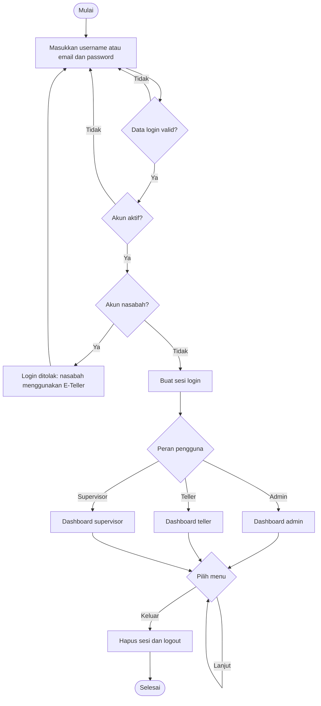
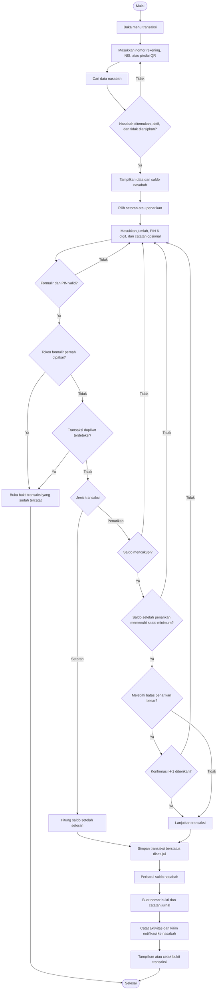
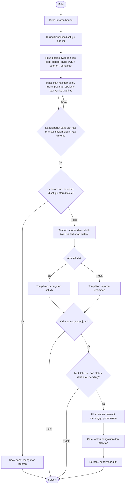
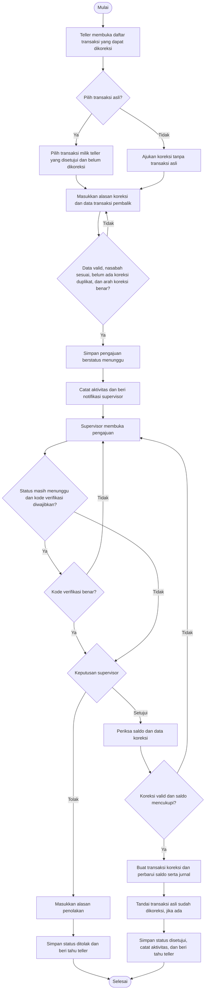
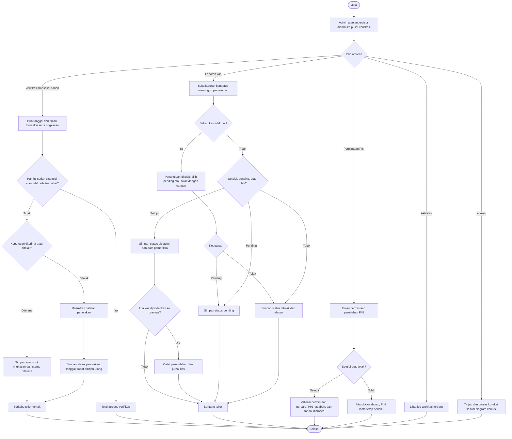
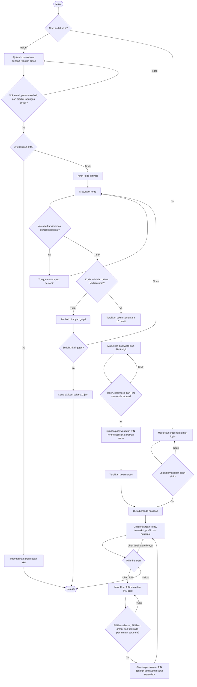
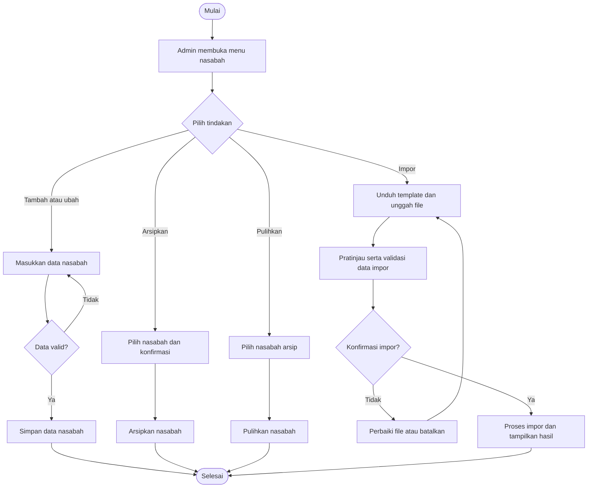
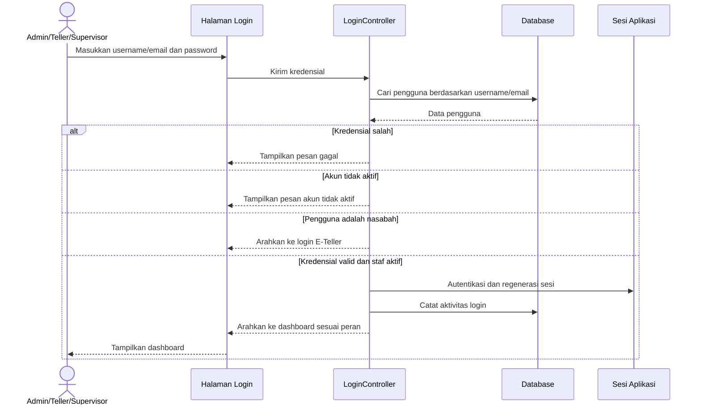
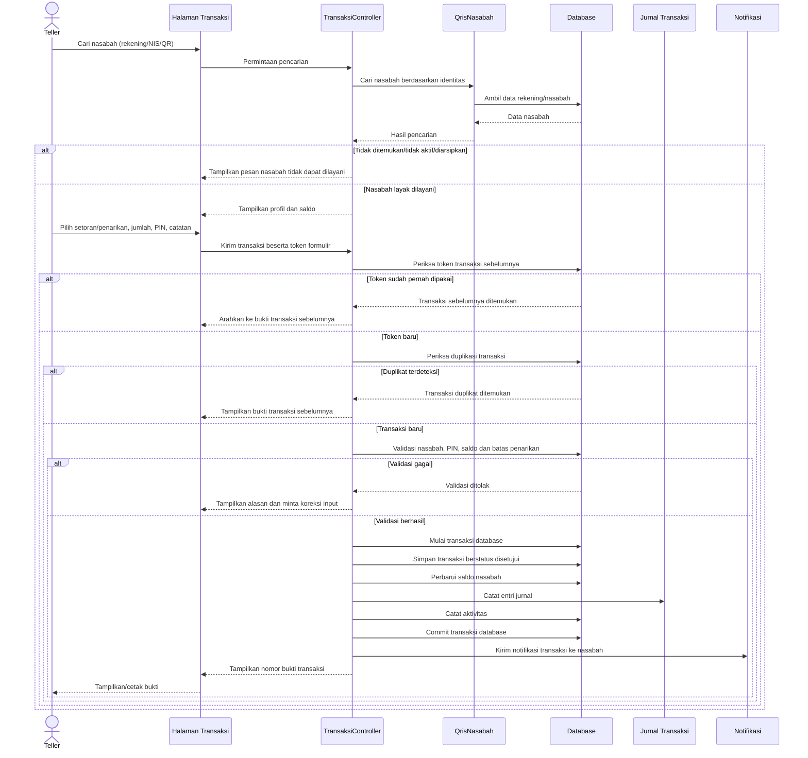
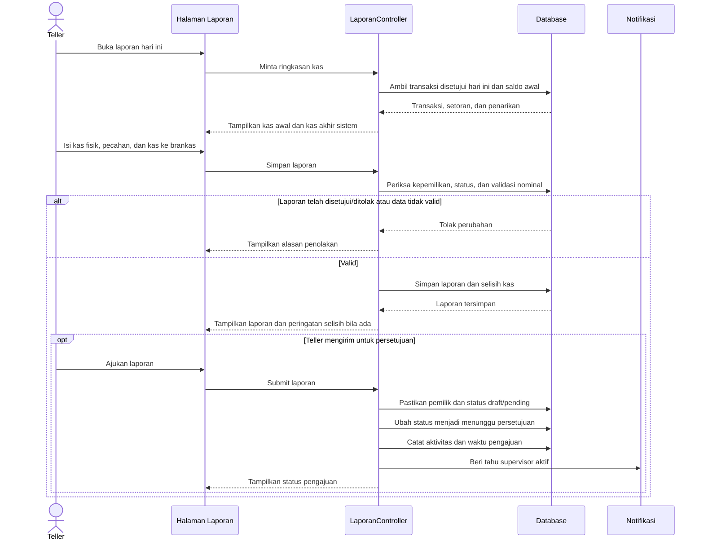

# Activity Diagram Sistem Bank Mini

Diagram ini merangkum alur yang diterapkan pada aplikasi: autentikasi staf, transaksi teller, laporan kas harian, koreksi, verifikasi supervisor, administrasi, serta layanan nasabah.

## 1. Login staf



## 2. Transaksi teller



## 3. Laporan kas harian teller



## 4. Pengajuan dan verifikasi koreksi transaksi



## 5. Persetujuan dan verifikasi supervisor



## 6. Portal dan aktivasi nasabah



## 7. Administrasi nasabah dan impor



# Sequence Diagram Sistem Bank Mini

Diagram sequence berikut menggambarkan pertukaran pesan antaraktor, aplikasi, dan penyimpanan data pada alur inti sistem.

## 1. Login staf



## 2. Transaksi teller



## 3. Pengajuan laporan kas harian



## 4. Pemeriksaan dan persetujuan supervisor

```mermaid
sequenceDiagram
    actor Supervisor as Supervisor/Admin
    participant UI as Pusat Verifikasi
    participant VC as VerifikasiController
    participant DB as Database
    participant Journal as Jurnal Kas
    participant Notify as Notifikasi

    Supervisor->>UI: Buka antrean laporan
    UI->>VC: Minta laporan menunggu persetujuan
    VC->>DB: Ambil laporan dan rincian kas
    DB-->>VC: Data laporan
    VC-->>UI: Tampilkan laporan
    Supervisor->>UI: Pilih setujui, pending, atau tolak
    UI->>VC: Kirim keputusan dan catatan
    VC->>DB: Periksa status dan selisih kas
    alt Laporan memiliki selisih dan diminta disetujui
        VC-->>UI: Tolak persetujuan; minta pending atau penolakan
    else Keputusan pending
        VC->>DB: Ubah status menjadi pending
        VC->>Notify: Beri tahu teller
        VC-->>UI: Tampilkan status pending
    else Keputusan ditolak
        VC->>DB: Simpan status ditolak dan alasan
        VC->>Notify: Beri tahu teller
        VC-->>UI: Tampilkan status ditolak
    else Disetujui tanpa selisih
        VC->>DB: Simpan status, pemeriksa, waktu, dan catatan
        opt Ada kas yang dipindahkan ke brankas
            VC->>DB: Catat pemindahan kas
            VC->>Journal: Catat jurnal pemindahan
        end
        VC->>Notify: Beri tahu teller
        VC-->>UI: Tampilkan status disetujui
    end
```

## 5. Nasabah mengajukan perubahan PIN

```mermaid
sequenceDiagram
    actor Nasabah
    participant App as Aplikasi E-Teller
    participant API as API Nasabah
    participant PIN as PermintaanPinService
    participant DB as Database
    participant Notify as Notifikasi Admin/Supervisor

    Nasabah->>App: Masukkan PIN lama dan PIN baru
    App->>API: Kirim permintaan dengan token autentikasi
    API->>PIN: Validasi dan proses pengajuan
    PIN->>DB: Ambil data nasabah dan permintaan PIN aktif
    DB-->>PIN: Data PIN dan status pengajuan
    alt PIN lama salah/PIN baru lemah atau sama/ada permintaan menunggu
        PIN-->>API: Tolak permintaan beserta alasan
        API-->>App: Tampilkan pesan validasi
    else Permintaan valid
        PIN->>DB: Simpan hash PIN baru sebagai permintaan menunggu
        PIN->>Notify: Beri tahu admin dan supervisor aktif
        PIN-->>API: Kembalikan status pengajuan
        API-->>App: Tampilkan konfirmasi pengajuan
    end
    opt Admin atau supervisor memproses permintaan
        actor Petugas as Admin/Supervisor
        Petugas->>API: Setujui atau tolak permintaan
        API->>PIN: Proses keputusan
        PIN->>DB: Kunci dan periksa permintaan yang masih menunggu
        alt Disetujui
            PIN->>DB: Terapkan hash PIN ke nasabah dan rekening
            PIN->>DB: Tandai permintaan diproses
        else Ditolak dengan alasan
            PIN->>DB: Tandai ditolak; PIN lama tetap berlaku
        end
        PIN-->>API: Hasil pemrosesan
        API-->>Petugas: Tampilkan hasil keputusan
    end
```
